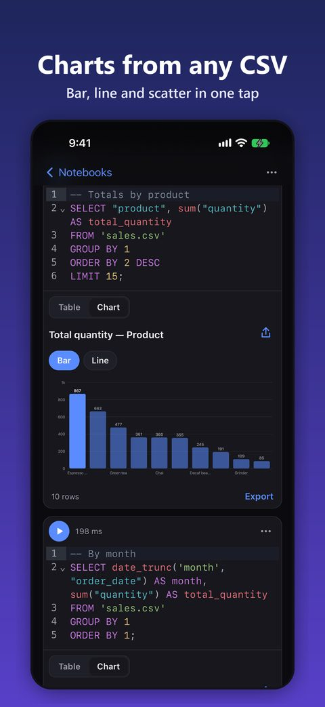
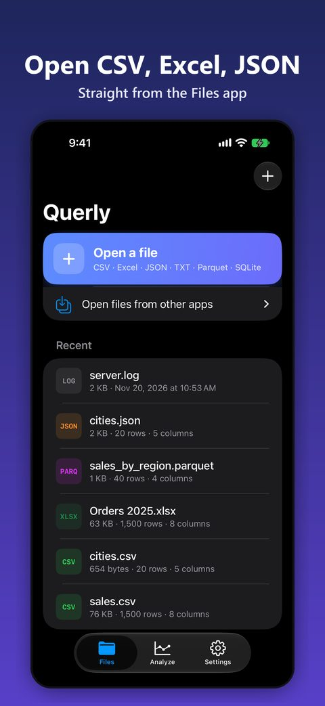
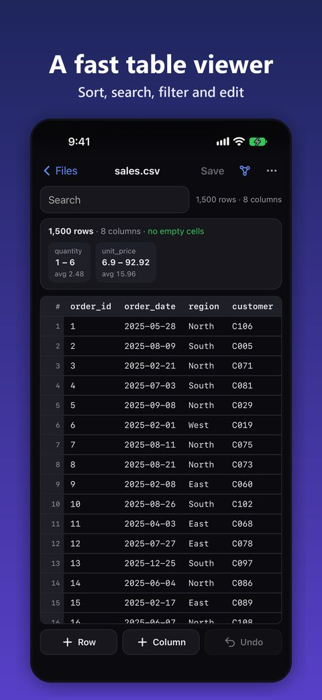
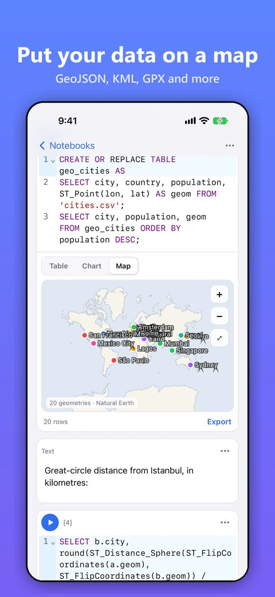
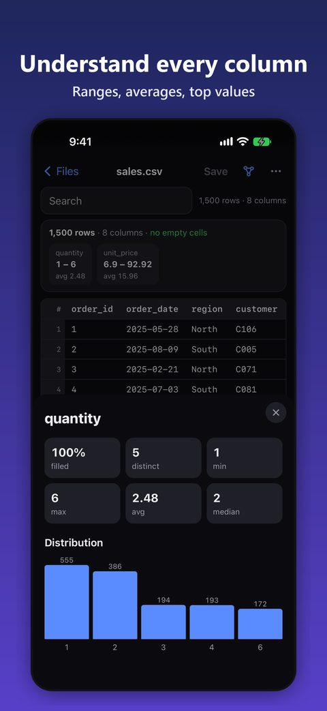
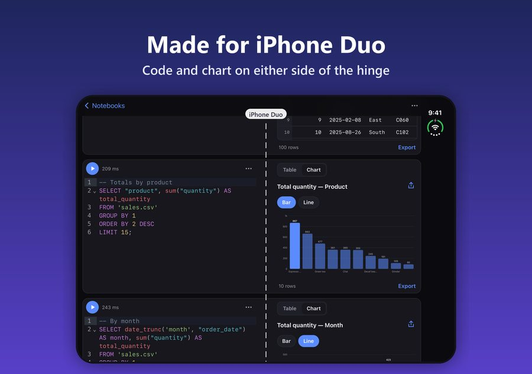
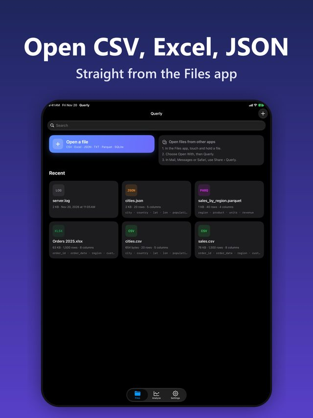
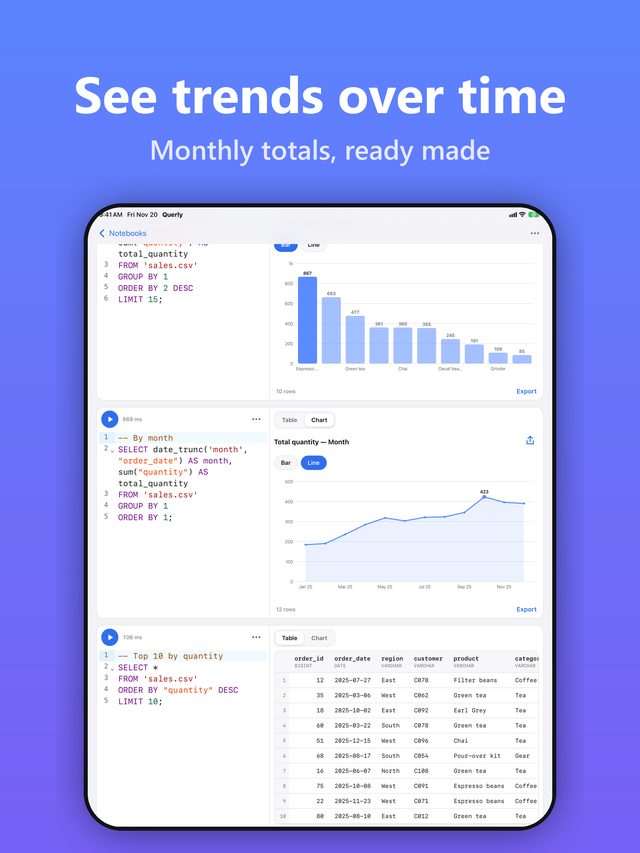

<p align="center">
  
</p>

<h1 align="center">Querly: CSV Viewer & Charts</h1>

<p align="center">
  <b>Open CSV, Excel, JSON, SQLite and Parquet files on iPhone and iPad, see them as a table, and turn them into charts in one tap.</b><br>
  DuckDB runs on the device: no upload, no server, no account. Made for iPhone Duo.
</p>

<p align="center">
  <a href="https://apps.apple.com/app/id6835789553"></a>
</p>

<p align="center">
  
  
  
  
  
</p>

**[Get Querly on the App Store](https://apps.apple.com/app/id6835789553)**: free, with a one-time Pro purchase for charts, maps and SQL on Excel, Parquet and SQLite.

## Open CSV, Excel and JSON files on iPhone

**How do I open a CSV file on my iPhone?** In the Files app, touch and hold the file, choose *Open With › Querly*
(or *Share › Querly* from Mail, Messages or Safari). It opens as a table you can sort, search and filter. CSV, TSV
and TXT files can be edited cell by cell and saved back to Files, keeping their delimiter and untouched values.

**Can I view Excel, Parquet or SQLite files on iOS?** Yes, for free: `.xlsx`, `.parquet`, `.sqlite` / `.db`,
`.json`, `.jsonl`, `.csv.gz`, plus any text file (logs, Markdown, code). Pictures, PDFs and documents open in
Quick Look.

**Can I make charts from a spreadsheet on my phone?** Tap *Analyze* on any file: Querly writes ready-made
questions for it (totals by category, the trend by month, the top 10, two numbers against each other) and shows
the answers as bar, line and scatter charts you can share as images.

**What is in my data?** Every table opens with an overview: rows, columns, how many cells are empty, and the range
and average of each number column. Tap a column for a histogram or its most common values.

## Run DuckDB on iPhone and iPad

**How do I run DuckDB on my iPhone?** Install [Querly](https://apps.apple.com/app/id6835789553). It runs DuckDB 1.5
([DuckDB-Wasm](https://github.com/duckdb/duckdb-wasm)) entirely on the device, offline. Every analysis is an
editable SQL notebook: query files by name (`SELECT * FROM 'sales.csv'`), join them, use `PIVOT`, window
functions and `QUALIFY`, and summarise millions of rows in a moment.

**Which DuckDB extensions work offline?** parquet, json, excel, icu, spatial (GDAL, GEOS, PROJ), sqlite_scanner,
fts, inet, vss, tpch, tpcds and autocomplete, all bundled in the app; nothing is downloaded.

**Where are my files?** In *Files › On My iPhone › Querly*. Nothing leaves the device.

## iPad and iPhone Duo

<p align="center">
  
  
  
</p>

Querly is a native iPad app and is made for iPhone Duo. On wide screens (iPad, the open iPhone Duo, an iPhone in
landscape) notebooks put the SQL on the left and the result on the right, and the Files tab becomes a grid of
cards. On iPhone Duo the split follows the hinge, half open or flat. The notebook menu has *Layout: Automatic,
Side by side, Stacked*.

Also by the same developer: **[Tuple](https://github.com/heyobi/pgnotebook)**, a real PostgreSQL 18 server with
PostGIS and pgvector that runs on your iPhone ([App Store](https://apps.apple.com/us/app/tuple-sql-notebook/id6835658208)).

## Free and Pro

Free: viewing every supported file, CSV editing, table overview and column stats, SQL notebooks on CSV, TSV and
JSON files up to 25 MB, CSV export, lessons and examples, one database.
Pro (one-time purchase): charts and maps, SQL on Excel, Parquet and SQLite files, spatial SQL, Parquet/Excel/JSON
export, larger files, more databases, backups and restores.

## Tech

- DuckDB 1.5 via [DuckDB-Wasm](https://github.com/duckdb/duckdb-wasm) in a Web Worker, inside a Capacitor 8 app
- Native shell in Swift: system tab bar, SwiftUI Files screen with context menus and Quick Look, iPhone Duo hinge
  through `onHingeChange` and the `.division` reserved region (`ios/App/App/NativeShell.swift`)
- Notebooks stored as `.ipynb`; results as table, chart, map; export CSV / Parquet / Excel / JSON
- App Store screenshots taken in the iOS simulator on CI (`.github/workflows/screenshots.yml`), including both
  iPhone Duo displays

Powered by DuckDB. Querly is independent and not affiliated with or endorsed by the DuckDB Foundation.

## How it works

| Piece | Where |
|---|---|
| Worker that hosts DuckDB and maps extension loads to bundled files | `public/querly.worker.js` |
| Copies DuckDB's wasm/worker and downloads extensions (pinned SHA-256) | `scripts/duckdb-assets.mjs` |
| Engine: queries, files, snapshots (EXPORT/IMPORT DATABASE as Parquet) | `src/engine.ts` |
| Free/Pro rules and file kinds | `src/features.ts` |
| UI | `src/main.ts`, `src/results.ts`, `src/ui.ts` |

DuckDB runs in memory; after each change the database is exported as a Parquet snapshot into app storage and imported
again on launch.

## Develop

```bash
npm ci
npm run dev          # http://localhost:5199/?pro  (pro unlocks everything in the browser)
npm test             # unit tests
npm run build && npx vite preview --port 4183 --strictPort &
APP_URL='http://localhost:4183/?pro&selftest' node tests/webkit/app.mjs   # end-to-end in WebKit, network blocked
```

Test in WebKit (Playwright), not Chrome: it is the iOS engine.

## Release

`.github/workflows/ios-testflight.yml` type-checks, runs the WebKit check, then builds, signs and uploads to TestFlight
on every push to `main`. Repository secrets: `APP_STORE_CONNECT_KEY_ID`, `APP_STORE_CONNECT_ISSUER_ID`,
`APP_STORE_CONNECT_PRIVATE_KEY`, `BUILD_CERTIFICATE_BASE64`, `P12_PASSWORD`, `KEYCHAIN_PASSWORD`.

## Licence

MIT. DuckDB is MIT-licensed. The spatial extension bundles GDAL, GEOS and PROJ.
